<p align="center"></p>

<p align="center">     </p>
<p align="center"><a href="#english">English</a> · <a href="#español">Español</a></p>

<p align="center"><a href="https://www.youtube.com/watch?v=UubJcvpHcn4"></a><br><sub>▶ Demo video: closed-loop altitude control on the real rig (YouTube)</sub></p>

## English

### Overview
A brushless motor and propeller, driven through an ESC, lift a moving body along three vertical guide rods. A TFmini Plus LiDAR measures its height, and a PSoC 5LP regulates it. The identified plant is third order, integrating, open-loop unstable and non-minimum-phase, with strict actuator saturation, variable rail friction and battery discharge. The work includes mechanical design, sensor calibration, system identification, controller design in MATLAB, embedded implementation on the PSoC, and experimental comparison of classical and modern controllers on the physical plant. The full report (in Spanish) is in [`docs/technical-report.pdf`](docs/technical-report.pdf).


<p align="center">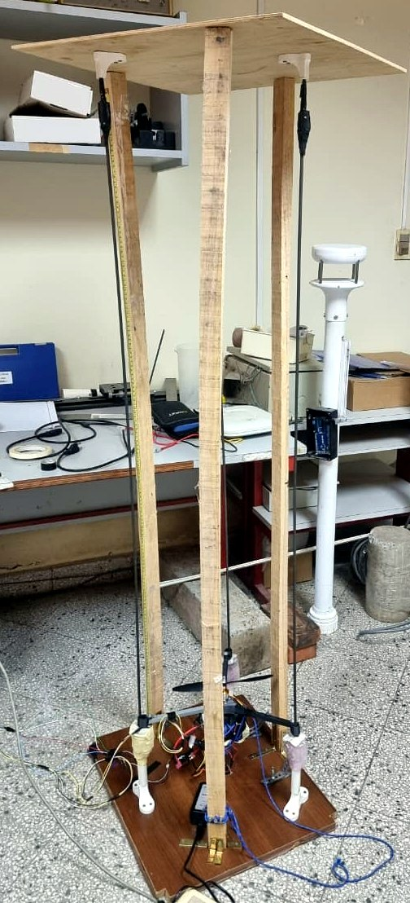<br><sub>Test rig: brushless motor body on three vertical guide rods, TFmini Plus LiDAR at the base.</sub></p>

### Highlights
- Identified continuous model, simplified to `G(s) = -0.12107 (s-14)(s+10.62) / (s (s^2 + 5.61 s + 14.02))`, valid for a PWM range of 1100-1700 us; a right-half-plane zero reproduces the initial inverse response seen in step tests.
- Controller families implemented and tested on the real rig: digital PID (Åström form with anti-windup), root locus, frequency response (Bode), direct synthesis, pole placement with state estimator (predictor and current observers), and optimal control (LQR, LQR with integrator, LQG with Kalman filter).
- In the report's conclusions, LQR + Kalman filter + integrator gave the best overall performance on this plant; classical methods were more tolerant to model errors.
- Embedded firmware with five runtime-selectable modes (transfer function, and state space with predictor/current observer, with or without integrator); coefficients are loaded from MATLAB over a UART protocol with per-word echo/ACK.
- Automatic hover-point estimation before each closed-loop session (PWM ramp at 1 kHz, detection of first sustained motion) and a hardware emergency stop that disables the ESC PWM.
- TFmini Plus distance calibration (polynomial and log-based fits exported to C headers) and noise/covariance estimation for the Kalman filter.

### System architecture
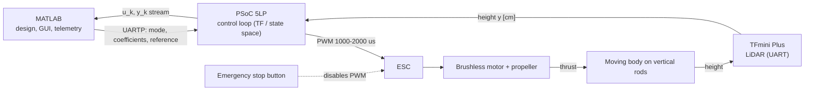

<p align="center">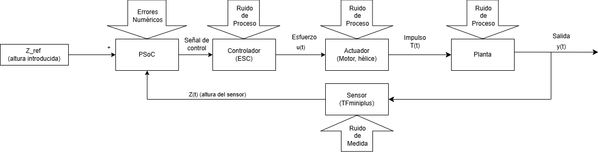<br><em>Block diagram of the implemented loop, including process, measurement and numerical noise sources.</em></p>

### Hardware
| Component | Role |
|---|---|
| PSoC 5LP | Real-time controller: sensor acquisition, control law, ESC PWM, UART protocol |
| TFmini Plus (LiDAR ToF) | Height measurement over UART |
| Brushless motor A2212/5T + propeller | Thrust actuator |
| ESC | Motor driver, commanded with a 50 Hz servo-type PWM (1000-2000 us) |
| 3S LiPo battery | Power source |
| Wooden frame, three guide rods, 3D-printed arms, clamps and supports | Mechanical structure; usable height about 134 cm; moving mass about 0.36 kg |
| Arduino | Sensor bring-up sketch (TFmini Plus and VL53L1X) |
| Emergency stop button | Disables the PWM module in hardware |

The rig is wired as a prototype setup; no custom PCB was used.

<p align="center">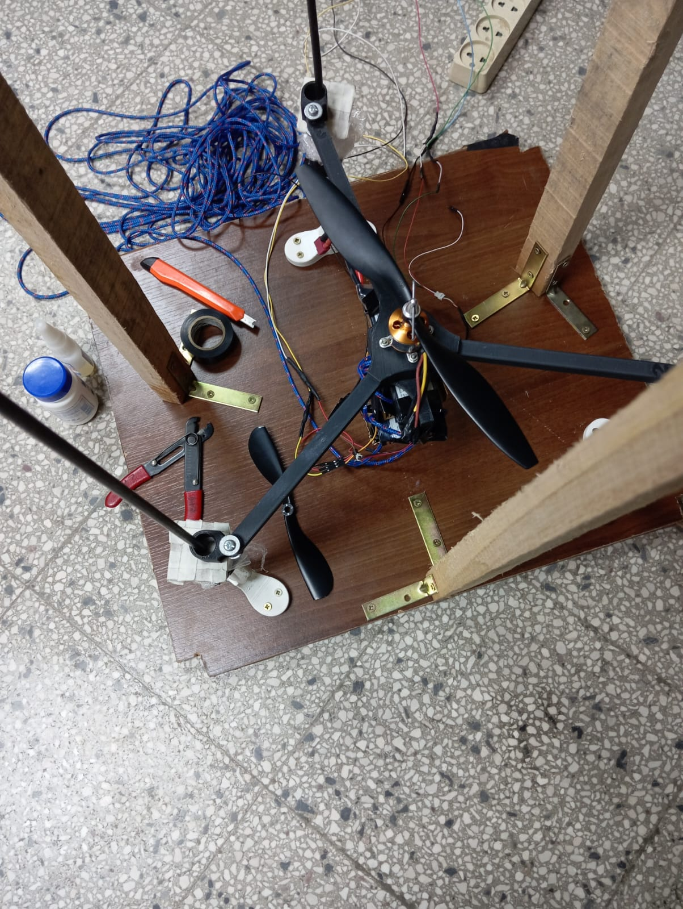 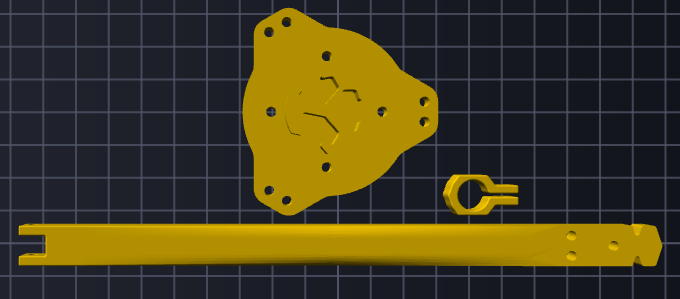<br><em>Moving body (left) and 3D-printed arm, hub and clamp prepared for printing (right).</em></p>

### Repository layout
```
.
├── docs/
│   ├── technical-report.pdf        # Full report (Spanish, 30 pages, IEEEtran)
│   ├── report-src/                 # LaTeX sources, bibliography and figures
│   └── img/                        # Figures used in this README
├── firmware/
│   ├── psoc/autoDron.cydsn/        # Final PSoC Creator project (control, TFmini driver, ESC PWM, UARTP)
│   └── arduino/sensor-bringup/     # Arduino sensor test sketch
├── matlab/
│   ├── controller-design/          # Gain computation, simulation of all controllers, discrete design helpers
│   ├── identification/             # System identification and model validation scripts
│   ├── sensor-calibration/         # TFmini Plus calibration and C header export
│   ├── host-interface/             # UARTP MATLAB API and control GUI
│   └── data/                       # Identified model, open-loop tests, per-controller experiment data, spreadsheets
├── hardware/cad/                   # STL / 3MF parts (arms, pivot, caps, battery holder, rail and block)
└── LICENSE
```

### Getting started
- **Report:** open `docs/technical-report.pdf`. To rebuild, run `pdflatex` and `bibtex` on `docs/report-src/document.tex` (packages: IEEEtran, babel Spanish, siunitx, listings, listingsutf8, subfig).
- **Firmware:** open `firmware/psoc/autoDron.cydsn/autoDron-000.cywrk` with PSoC Creator 4.x (project saved with 4.4). The project references the CMSIS-DSP sources (`arm_math.h`, `arm_add_f32.c`, `arm_dot_prod_f32.c`, `arm_scale_f32.c`) under `third_party/CMSIS-DSP/` at the repository root; obtain them from [ARM-software/CMSIS-DSP](https://github.com/ARM-software/CMSIS-DSP) and, for the include paths, [CMSIS_5](https://github.com/ARM-software/CMSIS_5). Program the PSoC 5LP with MiniProg3 or KitProg. `control_app.h` and `uartp_sw.h` were taken from the preceding firmware iteration of the same project, because the final folder did not contain them.
- **MATLAB:** add `matlab/` to the path. Use `matlab/host-interface` (`uartp_open`, `uartp_setmode`, `uartp_send_coeffs`, `uartp_init`, `uartp_stop`; see its README) to load a controller and run it, and `matlab/controller-design/simulacion_todos_controladores.m` to simulate all designs. Several scripts still contain the original absolute file paths in `load(...)` calls; adjust them to `matlab/data/`.
- Some `.mat` files from the original working folders were empty in the source and are not included.

### Results
Experimental runs on the real plant (output `y` in cm, control effort `u` as PWM offset in us, versus sample index; the sampling rate depends on the design, from 50 Hz to 1 kHz).

<p align="center">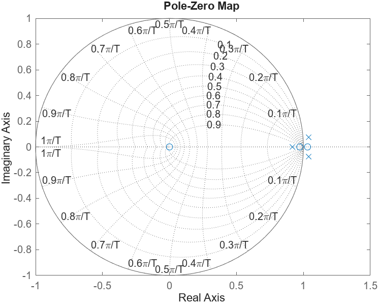<br><em>Pole-zero map of the discretised plant: poles and zeros cluster near z = 1.</em></p>
<p align="center">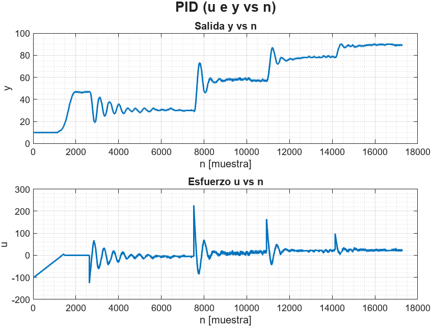<br><em>Digital PID: reference steps with oscillatory transients and bounded effort.</em></p>
<p align="center">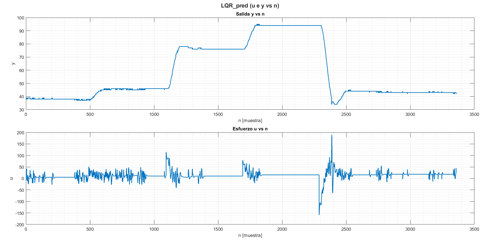<br><em>LQR with state estimator: reference steps tracked by the real plant.</em></p>
<p align="center">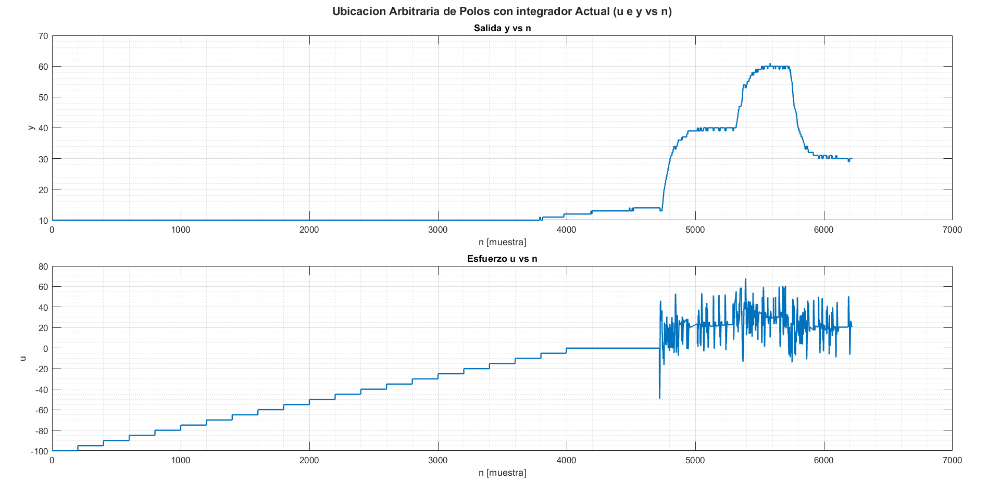<br><em>Pole placement with integral action and current observer: hover-point search followed by reference steps.</em></p>
<p align="center">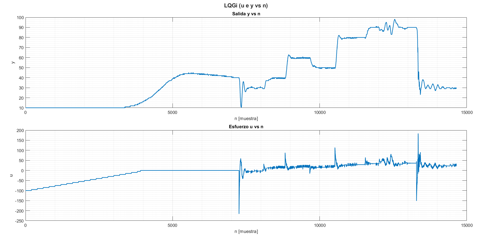<br><em>LQG with integrator (LQR + Kalman + integral action), the best-performing design in the report.</em></p>

Detailed simulation-versus-experiment comparisons, Bode and root-locus designs, and the discussion of each method are in the report.

### Prototype photos
<table><tr>
<td align="center" width="33%">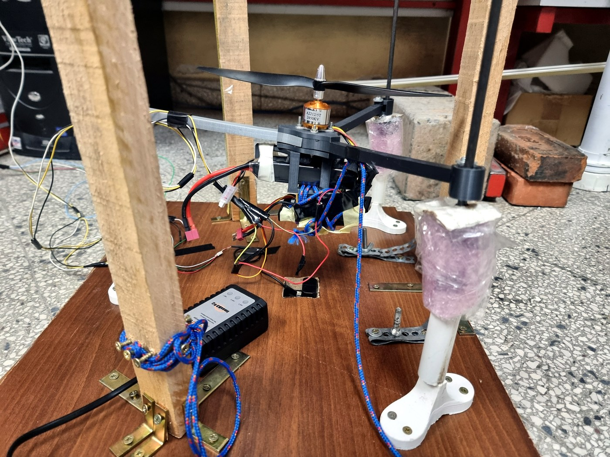<br><sub>Vertical rig with brushless motor and propeller</sub></td><td align="center" width="33%">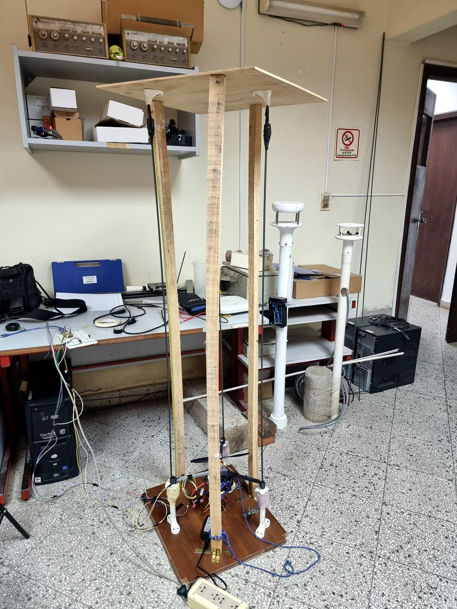<br><sub>Wooden vertical rig in the lab</sub></td><td align="center" width="33%">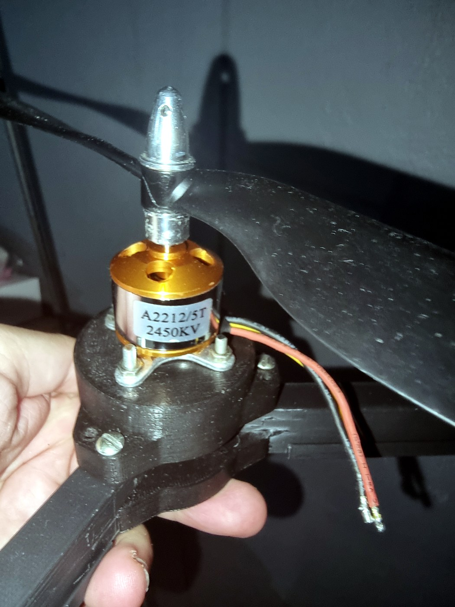<br><sub>Brushless motor with propeller adapter</sub></td>
</tr></table>

### Team & credits
Developed by Elías David Álvarez Martínez and Tania Romero at Universidad Católica "Nuestra Señora de la Asunción" (Paraguay), Electronics Engineering, 2026.

### License
MIT, see [`LICENSE`](LICENSE). The report and figures are shared for reference.

---

## Español

### Descripción general
Un motor brushless con hélice, accionado mediante un ESC, eleva un cuerpo móvil guiado por tres varillas verticales. Un LiDAR TFmini Plus mide la altura y un PSoC 5LP la regula. La planta identificada es de tercer orden, integradora, inestable en lazo abierto y de fase no mínima, con saturación estricta del actuador, fricción variable en los rieles y descarga de batería. El trabajo incluye el diseño mecánico, la calibración del sensor, la identificación de sistemas, el diseño de controladores en MATLAB, la implementación embebida en el PSoC y la comparación experimental de controladores clásicos y modernos sobre la planta física. El informe completo está en [`docs/technical-report.pdf`](docs/technical-report.pdf).

<p align="center"><br><sub>Banco de pruebas: cuerpo con motor brushless sobre tres varillas guía verticales y LiDAR TFmini Plus en la base.</sub></p>

### Aspectos destacados
- Modelo continuo identificado, simplificado a `G(s) = -0,12107 (s-14)(s+10,62) / (s (s^2 + 5,61 s + 14,02))`, válido para PWM entre 1100 y 1700 us; el cero en el semiplano derecho reproduce la respuesta inversa inicial observada en los ensayos al escalón.
- Familias de controladores implementadas y probadas en la planta real: PID digital (forma de Åström con anti-windup), lugar de las raíces, respuesta en frecuencia (Bode), síntesis directa, ubicación de polos con estimador de estados (predictor y actual) y control óptimo (LQR, LQR con integrador, LQG con filtro de Kalman).
- Según las conclusiones del informe, LQR + filtro de Kalman + integrador dio el mejor desempeño global; los métodos clásicos toleraron mejor los errores de modelo.
- Firmware con cinco modos seleccionables en tiempo de ejecución (función de transferencia y espacio de estados con observador predictor/actual, con o sin integrador); los coeficientes se cargan desde MATLAB mediante un protocolo UART con eco y ACK por palabra.
- Estimación automática del punto de sustentación antes de cada sesión en lazo cerrado (rampa PWM a 1 kHz, detección del primer movimiento sostenido) y parada de emergencia por hardware que deshabilita el PWM del ESC.
- Calibración de distancia del TFmini Plus (ajustes polinomiales y logarítmicos exportados a cabeceras C) y estimación de covarianzas de ruido para el filtro de Kalman.

### Arquitectura del sistema
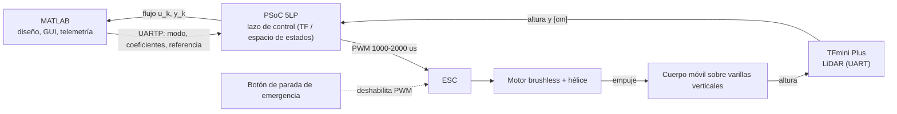

<p align="center"><br><em>Diagrama de bloques del lazo implementado, incluidas las fuentes de ruido de proceso, medición y cálculo numérico.</em></p>

### Hardware
| Componente | Función |
|---|---|
| PSoC 5LP | Controlador en tiempo real: adquisición, ley de control, PWM al ESC, protocolo UART |
| TFmini Plus (LiDAR ToF) | Medición de altura por UART |
| Motor brushless A2212/5T + hélice | Actuador de empuje |
| ESC | Driver del motor, comandado con PWM tipo servo de 50 Hz (1000-2000 us) |
| Batería LiPo 3S | Fuente de energía |
| Estructura de madera, tres varillas guía, brazos y soportes impresos en 3D | Estructura mecánica; altura útil de unos 134 cm; masa móvil de unos 0,36 kg |
| Arduino | Sketch de prueba de sensores (TFmini Plus y VL53L1X) |
| Botón de emergencia | Deshabilita el módulo PWM por hardware |

La planta está cableada como montaje de prototipo; no se usó una PCB propia.

<p align="center"> <br><em>Cuerpo móvil (izquierda) y brazo, cubo y abrazadera impresos en 3D y preparados para impresión (derecha).</em></p>

### Estructura del repositorio
```
.
├── docs/
│   ├── technical-report.pdf        # Informe completo (español, 30 páginas, IEEEtran)
│   ├── report-src/                 # Fuentes LaTeX, bibliografía y figuras
│   └── img/                        # Figuras utilizadas en este README
├── firmware/
│   ├── psoc/autoDron.cydsn/        # Proyecto final PSoC Creator (control, driver TFmini, PWM ESC, UARTP)
│   └── arduino/sensor-bringup/     # Sketch Arduino de prueba del sensor
├── matlab/
│   ├── controller-design/          # Cálculo de ganancias, simulación de todos los controladores, auxiliares de diseño discreto
│   ├── identification/             # Scripts de identificación de sistemas y validación del modelo
│   ├── sensor-calibration/         # Calibración del TFmini Plus y exportación de cabeceras C
│   ├── host-interface/             # API UARTP para MATLAB y GUI de control
│   └── data/                       # Modelo identificado, ensayos en lazo abierto, datos experimentales por controlador, planillas
├── hardware/cad/                   # Piezas STL / 3MF (brazos, pivote, tapas, soporte de batería, riel y bloque)
└── LICENSE
```

### Primeros pasos
- **Informe:** abrir `docs/technical-report.pdf`. Para recompilar, ejecutar `pdflatex` y `bibtex` sobre `docs/report-src/document.tex` (paquetes: IEEEtran, babel Spanish, siunitx, listings, listingsutf8, subfig).
- **Firmware:** abrir `firmware/psoc/autoDron.cydsn/autoDron-000.cywrk` con PSoC Creator 4.x (el proyecto se guardó con 4.4). El proyecto referencia las fuentes CMSIS-DSP (`arm_math.h`, `arm_add_f32.c`, `arm_dot_prod_f32.c`, `arm_scale_f32.c`) dentro de `third_party/CMSIS-DSP/` en la raíz del repositorio. Se obtienen de [ARM-software/CMSIS-DSP](https://github.com/ARM-software/CMSIS-DSP) y, para las rutas de inclusión, de [CMSIS_5](https://github.com/ARM-software/CMSIS_5). Programar el PSoC 5LP con MiniProg3 o KitProg. `control_app.h` y `uartp_sw.h` se tomaron de la iteración anterior del firmware del mismo proyecto, porque la carpeta final no los contenía.
- **MATLAB:** agregar `matlab/` a la ruta. Usar `matlab/host-interface` (`uartp_open`, `uartp_setmode`, `uartp_send_coeffs`, `uartp_init`, `uartp_stop`; consultar su README) para cargar y ejecutar un controlador, y `matlab/controller-design/simulacion_todos_controladores.m` para simular todos los diseños. Varios scripts conservan las rutas absolutas originales en llamadas `load(...)`; ajustarlas a `matlab/data/`.
- Algunos archivos `.mat` de las carpetas de trabajo originales estaban vacíos en la fuente y no se incluyen.

### Resultados
Ensayos experimentales en la planta real (salida `y` en cm, esfuerzo de control `u` como offset de PWM en us, frente al índice de muestra; la frecuencia de muestreo depende del diseño, de 50 Hz a 1 kHz).

<p align="center"><br><em>Mapa de polos y ceros de la planta discretizada: los polos y ceros se agrupan cerca de z = 1.</em></p>
<p align="center"><br><em>PID digital: escalones de referencia con transitorios oscilatorios y esfuerzo acotado.</em></p>
<p align="center"><br><em>LQR con estimador de estados: seguimiento de escalones de referencia en la planta real.</em></p>
<p align="center"><br><em>Ubicación de polos con acción integral y observador actual: búsqueda del punto de sustentación seguida por escalones de referencia.</em></p>
<p align="center"><br><em>LQG con integrador (LQR + Kalman + acción integral), el diseño con mejor desempeño según el informe.</em></p>

El informe contiene comparaciones detalladas entre simulación y experimento, diseños por Bode y lugar de las raíces, y la discusión de cada método.

### Fotos del prototipo
<table><tr>
<td align="center" width="33%"><br><sub>Banco vertical con motor brushless y hélice</sub></td><td align="center" width="33%"><br><sub>Banco vertical de madera en el laboratorio</sub></td><td align="center" width="33%"><br><sub>Motor brushless con adaptador de hélice</sub></td>
</tr></table>

### Equipo y créditos
Desarrollado por Elías David Álvarez Martínez y Tania Romero en la Universidad Católica "Nuestra Señora de la Asunción" (Paraguay), Ingeniería Electrónica, 2026.

### Licencia
MIT, ver [`LICENSE`](LICENSE). El informe y las figuras se comparten como referencia.
